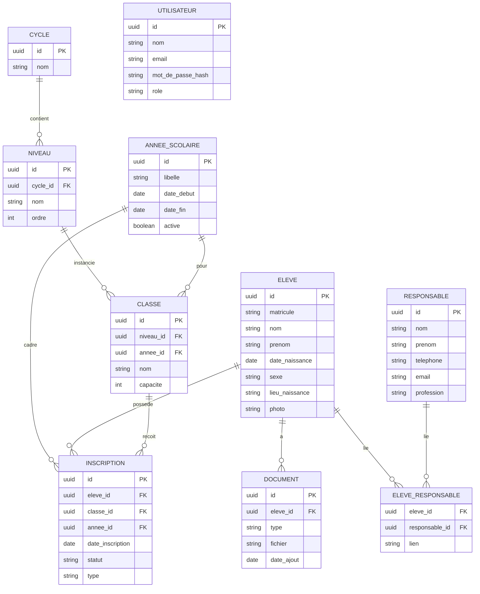
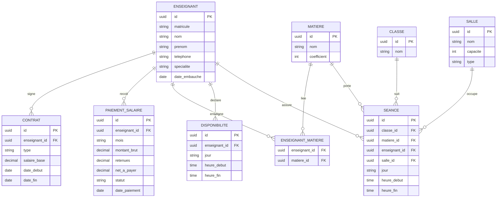

# Logiciel de gestion scolaire

Application web de gestion d'un établissement scolaire **multi-cycles** (primaire, collège, lycée…), construite **par phases** en commençant par la gestion des dossiers élèves et des inscriptions.

> **Vision cible détaillée : voir [`cahier-des-charges.md`](cahier-des-charges.md).** Ce document-ci reste le journal de bord des décisions et de l'avancement par phase ; le cahier des charges décrit le SIG complet visé (4 rôles, notes/bulletins, présences, paiements d'écolage, communication, rapports). Les deux ne sont pas encore réconciliés en détail — voir la section 11 ci-dessous pour les écarts identifiés.

---

## 1. Contexte et décisions déjà prises

| Décision                        | Choix retenu                   | Conséquence                                              |
| ------------------------------- | ------------------------------ | -------------------------------------------------------- |
| Processus prioritaire (phase 1) | Dossiers élèves + inscriptions | Périmètre net, essentiellement du CRUD                   |
| Type d'établissement            | Mixte / plusieurs cycles       | Modèle de données hiérarchique (cycle → niveau → classe) |
| Connectivité                    | Fiable en permanence           | Architecture web cloud classique,                        |
| Ambition                        | Évolutif par phases            | Le MVP = phase 1 d'une solution qui grandit              |

> Le MVP et la « solution complète » ne s'opposent pas : le MVP **est** la première phase. On construit un noyau utilisable, puis on empile les fonctions.

---

## 2. Stack technique — Laravel + Inertia + React

Stack retenue :

- **Laravel** — backend, ORM Eloquent, authentification, files d'attente (_queues_).
- **Inertia.js** — le pont : **pas d'API REST séparée à maintenir**. Laravel gère le routage et passe les données directement aux pages React.
- **React** — l'interface (composants, pages par rôle).

Pourquoi c'est cohérent ici :

- Inertia évite de construire et versionner une API séparée → développement plus rapide pour une app interne derrière authentification.
- Eloquent + le système de rôles/permissions de Laravel couvrent parfaitement les besoins CRUD et multi-rôles du projet.
- **Filament** (optionnel) peut servir de back-office rapide pour les tables de configuration internes (années, cycles, niveaux, salles, matières), en complément des pages Inertia/React destinées aux utilisateurs.

Paquets utiles à prévoir : `spatie/laravel-permission` (rôles fins), `spatie/laravel-medialibrary` (documents élèves), et les _queues_ Laravel pour les traitements lourds (génération de bulletins, envoi de notifications, calcul d'emploi du temps).

---

## 3. Les grandes étapes du projet (méthodologie)

### Étape 1 — Cadrage des besoins ✅ _(en grande partie fait)_

Lister qui utilise le logiciel, pour quoi, et avec quels rôles (admin, direction, secrétariat, enseignant, parent, élève). Définir le processus prioritaire.

### Étape 2 — Modélisation des données ⬅️ _(en cours)_

Modéliser les entités et leurs relations. C'est le cœur du projet : une base bien pensée évite une énorme dette technique. _(Voir section 4.)_

### Étape 3 — Périmètre de la phase 1

Ne pas tout construire d'un coup. Figer la liste précise des écrans et fonctions du noyau. _(Voir section 5.)_

### Étape 4 — Architecture et sécurité

- API séparée (backend/frontend découplés) ou monolithe.
- Authentification robuste + gestion fine des permissions par rôle.
- Chiffrement des données sensibles, sauvegardes automatiques.
- Les données scolaires sont des **données personnelles** : sujet légal à traiter dès le départ.

### Étape 5 — Développement

Backend d'abord (modèles, API, auth), puis frontend (interfaces par rôle), en itérant.

### Étape 6 — Tests, déploiement, maintenance

Tests automatisés sur la logique métier (calcul de moyennes, génération de bulletins…), déploiement, puis support et maintenance.

---

## 4. Modèle de données — Phase 1

Le triangle clé : **`ELEVE` ↔ `INSCRIPTION` ↔ `CLASSE`**.

> **Erreur à éviter :** mélanger « élève » et « classe » dans une seule table. On perd alors l'historique année par année et la progression entre cycles.

- **`ELEVE`** = une identité permanente, **un seul dossier** pour toute la scolarité.
- **`CLASSE`** = un niveau instancié pour une **année scolaire** donnée (« 6ème A – 2025/2026 »).
- **`INSCRIPTION`** = le pivot qui relie un élève à une classe pour une année. Un élève accumule une inscription par an → historique complet, aucune donnée dupliquée.
- **`CYCLE → NIVEAU → CLASSE`** = la hiérarchie qui gère nativement l'établissement multi-cycles. Ajouter un cycle plus tard ne casse rien.
- **`ELEVE_RESPONSABLE`** = relation plusieurs-à-plusieurs (un parent peut avoir plusieurs enfants ; un élève peut avoir père + mère + tuteur). **À prévoir dès maintenant.**

**Notes techniques :**

- `UTILISATEUR` porte un champ `role` (admin / secrétariat pour commencer) → base de l'authentification et des permissions.
- Les `DOCUMENT` **pointent vers un stockage de fichiers** (disque/objet cloud), on ne stocke pas les fichiers eux-mêmes en base.

---

## 4 bis. Modèle de données — Personnel enseignant & emploi du temps

Ce module couvre trois besoins liés : **gérer les enseignants**, **payer leurs salaires**, et **construire l'emploi du temps** de tous les professeurs.

Le pivot ici est l'entité **`SEANCE`** : un cours placé dans le planning, qui relie une classe, une matière, un enseignant, une salle et un créneau horaire (jour + heure). C'est l'équivalent, côté planning, de ce qu'était `INSCRIPTION` côté élèves.

- **`ENSEIGNANT`** : fiche du professeur (identité, spécialité, date d'embauche).
- **`CONTRAT`** : type de contrat et **salaire de base** (un enseignant peut avoir des contrats successifs).
- **`PAIEMENT_SALAIRE`** : un versement par mois, avec brut / retenues / net à payer et statut (payé, en attente).
- **`MATIERE`** et **`ENSEIGNANT_MATIERE`** : quelles matières chaque prof peut enseigner — indispensable pour la génération automatique.
- **`DISPONIBILITE`** : créneaux où l'enseignant est disponible — l'autre ingrédient clé du générateur.
- **`SALLE`** : les salles de classe et leur capacité.
- **`SEANCE`** : le cours planifié. `CLASSE` est partagée avec le modèle de la phase 1.

### Génération automatique de l'emploi du temps — à savoir

C'est **la fonction la plus complexe du projet**. Générer automatiquement un planning sur toutes les salles n'est pas une simple boucle : c'est un **problème d'optimisation sous contraintes** (_constraint satisfaction_). Le générateur doit respecter simultanément :

- un enseignant n'est jamais dans deux salles au même créneau ;
- une classe n'a jamais deux cours au même créneau ;
- une salle n'accueille jamais deux cours au même créneau ;
- on respecte les **disponibilités** de chaque enseignant ;
- on respecte le **volume horaire** de chaque matière par classe ;
- (souhaitable) éviter les « trous », équilibrer la charge sur la semaine, regrouper les matières.

Plus il y a de classes, de profs et de salles, plus le nombre de combinaisons explose. Approche recommandée, en deux temps :

1. **D'abord un éditeur manuel avec détection de conflits en temps réel.** L'utilisateur place les cours, et l'app signale immédiatement tout chevauchement (prof, salle ou classe). C'est rapide à livrer et déjà très utile.
2. **Ensuite la génération automatique**, via un algorithme de résolution de contraintes. Le calcul est lourd : il est préférable de le déléguer à un _worker_ (queue Laravel) plutôt que de bloquer la requête web, voire à un micro-service dédié si le volume est important. À traiter comme un vrai chantier, dans sa propre phase.

---

## 5. Périmètre de la phase 1 (à construire)

- [x] Authentification + rôles à 4 niveaux (admin, responsable_pedagogique, enseignant, etudiant) alignés sur le cahier des charges, avec permissions et scoping par rôle — inscription de test incluse (désactivée en production)
- [x] Gestion des **années scolaires** — modèle + seeder ; pas encore d'écran CRUD dédié
- [x] Configuration **cycles / niveaux / classes** — modèle + seeder ; pas encore d'écran CRUD dédié
- [x] **Fiche élève** : création, consultation, modification
- [ ] Gestion des **responsables** et lien avec les élèves — affichage en place, pas encore de formulaire d'ajout/liaison
- [x] **Formulaire d'inscription / réinscription** (élève → classe → année) — double inscription bloquée
- [ ] **Upload de documents** (acte de naissance, bulletins antérieurs, certificats) — modèle prêt, pas d'UI
- [x] **Recherche et filtres** (par nom, matricule, classe)
- [x] **Listes** : élèves par classe — effectifs par niveau pas encore agrégés
- [ ] Export basique (liste de classe en PDF/Excel)
- [x] Tableau de bord avec navigation vers tous les modules cibles (les modules non construits sont visibles mais désactivés)

---

## 6. Feuille de route des phases suivantes

| Phase                              | Contenu                                                               | Points d'attention                                                                   |
| ---------------------------------- | --------------------------------------------------------------------- | ------------------------------------------------------------------------------------ |
| **1. Dossiers & inscriptions**     | Élèves, responsables, classes, documents                              | _(noyau CRUD élèves/inscriptions livré ; documents et gestion des responsables restent à finir — section 5)_ |
| **2. Scolarité**                   | Présences, notes, bulletins                                           | Coefficients variables selon le cycle                                                |
| **3. Personnel enseignant & paie** | Fiches enseignants, contrats, **paiement des salaires**               | Bulletins de paie, historique des versements ; mobile money possible                 |
| **4. Emploi du temps**             | Planning de tous les profs, **génération automatique** sur les salles | Fonction la plus complexe du projet — voir section 4 bis                             |
| **5. Finances (élèves)**           | Frais de scolarité, factures, encaissements                           | **Mobile money** (MVola, Orange Money, Airtel Money) plutôt que prélèvement bancaire |
| **6. Communication**               | Portail / notifications parents                                       | Comptes parents en consultation                                                      |
| **7. Extensions**                  | Statistiques, rapports ministériels                                   | Selon les besoins qui émergent                                                       |

> **Ordre conseillé :** garder l'emploi du temps (phase 4) après la mise en place des enseignants (phase 3), car le générateur a besoin des fiches profs, de leurs matières et de leurs disponibilités pour fonctionner.

---

## 7. Points de vigilance transverses

- **Sécurité** : hachage des mots de passe, permissions par rôle, sauvegardes automatiques régulières.
- **Protection des données** : Madagascar dispose de sa propre loi sur la protection des données personnelles (distincte du RGPD). Les données scolaires sont sensibles → à intégrer dès la conception (_privacy by design_).
- **Paiements** : anticiper l'intégration mobile money dès la phase 3, très différente d'un prélèvement bancaire à l'européenne.
- **Migration** : si des données existent (Excel, papier), prévoir un import propre au moment de la phase 1, mais cela ne bloque pas le démarrage.

---

## 8. Prochaine étape suggérée

Stack tranchée : **Laravel + Inertia + React**. Le noyau de la phase 1 (projet initialisé, auth + rôles, modèles/migrations, CRUD élèves, formulaire d'inscription, tableau de bord) est livré. Restant pour clore proprement la phase 1, par ordre de priorité :

1. Formulaire de gestion des responsables (créer/lier un responsable à un élève depuis la fiche élève).
2. Upload de documents élève (acte de naissance, certificats…) sur le modèle `Document` déjà en place.
3. Écrans CRUD pour années scolaires / cycles / niveaux / classes (aujourd'hui seedés, pas administrables depuis l'UI).
4. Export basique (liste de classe en PDF/Excel).

Ensuite, voir la section 11 pour la mise en cohérence avec le cahier des charges avant d'attaquer la phase 2.

---

## 11. Écarts avec le cahier des charges

Le [`cahier-des-charges.md`](cahier-des-charges.md) décrit une cible beaucoup plus large que la phase 1 (4 rôles avec permissions fines, notes/bulletins, présences, paiements d'écolage, messagerie, rapports). Écarts structurants à trancher **avant** de commencer la phase 2, car ils touchent le socle (auth, modèle de données) :

| Sujet | État actuel | Cible du cahier des charges | Impact |
| --- | --- | --- | --- |
| Rôles | ✅ `admin`, `responsable_pedagogique`, `enseignant`, `etudiant` — permissions spatie (`eleves.view`, `eleves.manage`, `inscriptions.manage`) posées sur le seul module existant (Élèves), avec scoping objet (`ElevePolicy`) : un étudiant ne voit que son propre dossier (`users.eleve_id`) | Mêmes 4 rôles, permissions fines par module | Fondation posée ; à étendre à chaque nouveau module (ex. un enseignant ne devra voir que les élèves de ses classes une fois `SEANCE`/affectations construites — pas encore possible, ces données n'existent pas) |
| Filières | Absentes (seul `cycle → niveau → classe`) | `Filière` (Scientifique, Littéraire, Technique…) rattachée à la classe | Migration à ajouter, FK sur `classe` |
| Notes/bulletins | Non construit | Module 3.3 complet (notes, coefficients, moyennes, bulletins) | Phase 2 de `map.md` |
| Présences | Non construit | Module 3.4 complet (présence quotidienne, justificatifs, alertes) | Phase 2 de `map.md` |
| Paiements d'écolage | Non construit | Module 3.5 complet (frais, paiements, quittances, statuts, mobile money) | Correspond à la phase 5 de `map.md`, mais le cahier des charges la place bien avant les phases 3/4 (paie enseignants, emploi du temps) |
| Communication | Non construit | Module 3.6 (notifications, messagerie interne, email/SMS) | Phase 6 de `map.md` |
| Portail étudiant | Rôle et scoping des données posés (l'étudiant seedé voit son propre dossier élève) ; aucune page dédiée (tableau de bord personnel, notes, présences…) | Module 2.4 complet en lecture seule | Le socle d'accès existe, l'UI reste à construire au fur et à mesure des modules (notes, présences…) |

**Note sur `/register`** : une route d'auto-inscription a été ajoutée pour créer rapidement des comptes de test (assignés au rôle `admin`). Elle est désactivée en environnement `production` (`routes/auth.php`) et devra être supprimée une fois un vrai module de gestion des utilisateurs construit (section 2.1 du cahier des charges).
